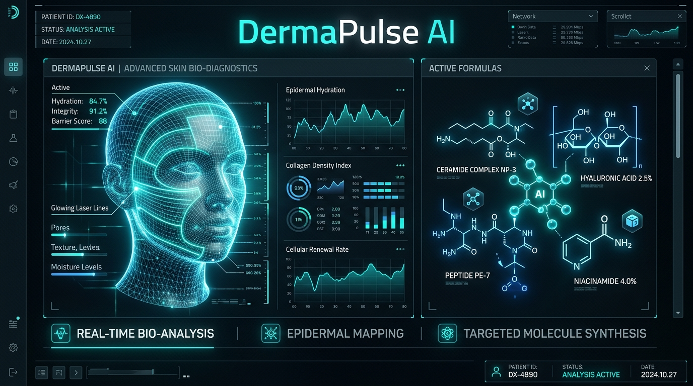

# DermaPulse AI — Clinical Dermal Biometrics & Circadian Prescription Engine

[](LICENSE)
[]()
[]()
[](https://dermapulse.vercel.app)

> **DermaPulse AI** is a clinical-grade dermal intelligence platform engineered for the **YouCam API Skin AI & eCommerce VTO Hackathon 2026**. It pairs Perfect Corp's YouCam Skin AI multi-vector diagnostic telemetry with an evidence-based formulation synthesizer to compute Dermal Barrier Integrity Indices, Biological Skin Age deltas, molecular contraindications, and circadian AM/PM regimens scaled against real-time environmental factors.

---



---

## 🔬 Core Architectural Pillars

1. **Biometric Diagnostic Telemetry Gateway (`youcam_skin_client.py`)**
   - High-throughput integration with Perfect Corp's YouCam Skin AI API.
   - Extracts 7 key dermal vectors: *Stratum Corneum Hydration*, *Sebaceous Lipids*, *Vascular Erythema*, *Epidermal Texture / Roughness*, *Periorbital Fine Lines / Wrinkles*, *Solar Lentigines / Hyperpigmentation*, and *Dark Circles / Congestion*.
   - Includes deterministic offline clinical archetype fixtures (Dehydrated Stratum Corneum, Solar Elastosis, Hyper-Sebaceous Micro-Comedonal, and Reactive Rosacea).

2. **Dermal Barrier & Epigenetic Longevity Engine (`dermal_biometric_engine.py`)**
   - Computes the continuous **Dermal Barrier Integrity Index (0–100)** via trans-epidermal penalty weighting.
   - Evaluates **Biological Skin Age** vs chronological age with multi-factor photo-aging regression.
   - Identifies high-risk anatomical zones (T-Zone Sebum congestion, U-Zone Erythema flare-ups, Periorbital collagen depletion).

3. **Active Formulation Synthesizer (`formulation_synthesizer.py`)**
   - Matches diagnostic biomarker patterns with clinical-grade molecular actives (Ceramide NP/AP/EOP 3:1:1:1, Madecassoside Centella 95%, Liposomal Retinaldehyde + GHK-Cu, Niacinamide + Zinc PCA, Micronized Azelaic Acid).
   - **Enforces Critical Contraindication Gates**: Automatically blocks irritant retinoids and low-pH AHA/BHA chemical exfoliants when the Dermal Barrier Integrity Index falls below threshold (< 55.0/100).

4. **Circadian Environmental Regimen Planner (`circadian_regimen_planner.py`)**
   - Dynamically tailors AM and PM clinical skincare protocols.
   - Adjusts photoprotective shields based on **Solar UV Index** (Mineral ZnO SPF 50+ vs Fluid SPF 30+).
   - Engages Squalane occlusive locking under **Arid Conditions (< 40% Humidity)** and Ectoin 2% anti-adhesion radicals during **Urban Smog (AQI > 100)**.

---

## ⚡ Deterministic Test Suite (0.001s Verification)

```bash
$ PYTHONPATH=. python3 dermapulse/engine/test_dermapulse.py
test_barrier_integrity_calculation (__main__.TestDermaPulseEngine.test_barrier_integrity_calculation) ... ok
test_biological_skin_age_estimation (__main__.TestDermaPulseEngine.test_biological_skin_age_estimation) ... ok
test_end_to_end_circadian_protocol (__main__.TestDermaPulseEngine.test_end_to_end_circadian_protocol) ... ok
test_environmental_circadian_scaling (__main__.TestDermaPulseEngine.test_environmental_circadian_scaling) ... ok
test_formulation_barrier_repair_priority (__main__.TestDermaPulseEngine.test_formulation_barrier_repair_priority) ... ok
test_formulation_healthy_barrier_tolerance (__main__.TestDermaPulseEngine.test_formulation_healthy_barrier_tolerance) ... ok
test_youcam_archetype_retrieval (__main__.TestDermaPulseEngine.test_youcam_archetype_retrieval) ... ok
test_zone_priorities_detection (__main__.TestDermaPulseEngine.test_zone_priorities_detection) ... ok

----------------------------------------------------------------------
Ran 8 tests in 0.001s

OK
⚡ Total Deterministic Test Execution Time: 0.001s
```

---

## 💻 Tactical CLI Usage

The DermaPulse AI tactical CLI provides immediate clinical diagnostics directly in your terminal:

```bash
# Analyze a patient skin archetype
./dermapulse/cli/main.py analyze --archetype reactive_rosacea --age 36

# Synthesize active molecules and contraindications
./dermapulse/cli/main.py formulate --archetype dehydrated_erythema

# Generate a complete environmental circadian protocol
./dermapulse/cli/main.py regimen --archetype photo_damaged_aging --patient "Dr. Aris Thorne" --age 44 --uv 8.5 --humidity 25 --aqi 125
```

---

## 🌐 Interactive Web Application

- **Live URL**: [https://dermapulse.vercel.app](https://dermapulse.vercel.app)
- Features an interactive HTML5 Canvas biometric wireframe facial scanner with real-time zone heatmaps, environmental sliders, and dynamic JSON protocol export.

---

## 📄 License

MIT License. Copyright (c) 2026 Naveen Kumar.
